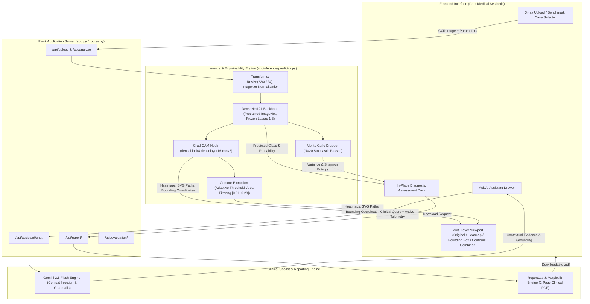

# AlveoSage
### Explainable AI-Powered Chest X-ray Analysis Assistant

[](https://www.python.org/)
[](https://pytorch.org/)
[](https://flask.palletsprojects.com/)
[](https://deepmind.google/technologies/gemini/)
[](https://opencv.org/)
[](https://github.com/)

**AlveoSage** is an experimental, clinical decision-support application designed to analyze pediatric chest radiographs (CXRs), classify findings into **NORMAL** or **PNEUMONIA**, generate multi-layer visual saliency attribution with **Grad-CAM**, quantify epistemic uncertainty using **Monte Carlo Dropout**, operate on a validation-optimized decision threshold ($\tau = 0.80$), provide contextual medical insights through **Gemini 2.5 Flash**, and generate publication-quality clinical PDF reports.

---

> [!IMPORTANT]
> **Investigational Research Device Notice**: AlveoSage is an experimental research system designed exclusively for scientific evaluation, academic investigation, and demonstration. It is **not clinically certified** (FDA, CE-IVD, or equivalent) and must not be used as an autonomous diagnostic device. All machine learning predictions, visual saliency regions, and epistemic uncertainty metrics require verification by a licensed physician or board-certified radiologist.

---

## Table of Contents

1. [Project Overview](#project-overview)
2. [Key Capabilities](#key-capabilities)
3. [System Architecture](#system-architecture)
4. [Application Screenshots](#application-screenshots)
5. [Model Training & Benchmark Performance](#model-training--benchmark-performance)
6. [Explainability & Uncertainty Methodology](#explainability--uncertainty-methodology)
7. [Technology Stack](#technology-stack)
8. [Repository Structure](#repository-structure)
9. [Dataset Curation & Integrity](#dataset-curation--integrity)
10. [Installation & Setup](#installation--setup)
11. [Running the Application](#running-the-application)
12. [Limitations & Ethical Considerations](#limitations--ethical-considerations)
13. [Future Roadmap](#future-roadmap)
14. [References & Citations](#references--citations)
15. [Contributing](#contributing)

---

## Project Overview

Deep convolutional neural networks achieve competitive performance on medical radiographic benchmarks. However, standard classifiers deployed in safety-critical clinical environments face three fundamental obstacles:

1. **The "Black Box" Interpretability Problem**: High-confidence predictions without transparent visual justification make clinical verification and auditability difficult for radiologists.
2. **Uncalibrated Model Confidence**: Standard softmax outputs often reflect overconfident probabilities on borderline or out-of-distribution cases, failing to quantify whether the network is genuinely certain.
3. **Class-Imbalance False Alarm Burdens**: Operating at default decision thresholds ($\tau = 0.50$) under skewed pre-test probabilities generates excessive false positives, creating alarm fatigue and unnecessary diagnostic interventions.

### Objectives

AlveoSage addresses these challenges through a unified decision-support architecture:
- **High-Sensitivity Screening**: Maintains $\ge 99\%$ sensitivity on pneumonia cases while controlling the false-positive rate.
- **Validation-Optimized Operating Threshold ($\tau = 0.80$)**: Replaces arbitrary $0.50$ cutoffs with a threshold derived via Youden's $J$ statistic on validation data, eliminating 28.4% of false positives on the independent test set with zero test-set tuning.
- **Dual-Layer Feature Attribution**: Combines continuous Grad-CAM activation heatmaps with adaptive focal attention contours and anatomical quadrant localization (e.g., *Right Lung - Mid Zone*).
- **Epistemic Uncertainty Quantification**: Implements Monte Carlo Dropout ($N = 20$ stochastic forward passes) to compute predictive variance ($\sigma^2$) and normalized Shannon entropy ($H$), stratifying cases into qualitative risk tiers (**LOW**, **MODERATE**, **HIGH**).
- **Grounded Conversational Intelligence**: Integrates **Gemini 2.5 Flash** as an interactive clinical copilot (*Ask AI*) grounded directly in the active radiograph's numerical telemetry, uncertainty scores, and spatial coordinates under strict medical safety guardrails.
- **Structured Documentation**: Exports publication-quality, 2-page medical PDF reports with multi-panel radiographic imaging, calibration statistics, and diagnostic telemetry.

---

## Key Capabilities

| Capability | Implementation | Clinical & Technical Purpose | Status |
| :--- | :--- | :--- | :---: |
| **Pneumonia Classification** | DenseNet121 with custom adaptive pooling head | Identifies pediatric pneumonia from AP chest radiographs with high sensitivity ($\ge 99\%$). | Implemented |
| **Operating Threshold Optimization** | Validation Youden's $J$ cutoff ($\tau = 0.80$) | Reduces test false positives from 88 to 63 while elevating specificity from $62.39\%$ to $73.08\%$. | Implemented |
| **Visual Attribution (Grad-CAM)** | Hook-based gradients from `denseblock4.denselayer16.conv2` | Visualizes the anatomical regions driving the network's classification with Jet colormapping. | Implemented |
| **Attention Focus Localization** | Coordinate bounding box with quadrant detection | Calculates normalized coordinates ($x_{\min}, y_{\min}, w, h$) and identifies anatomical lung zones. | Implemented |
| **Region Contour Extraction** | Adaptive focal thresholding & morphological filtering | Extracts multi-region focal attention clusters bounded within $[1.0\%, 28.0\%]$ image area. | Implemented |
| **Epistemic Uncertainty** | Monte Carlo Dropout ($N=20$ passes, eval mode) | Calculates predictive variance ($\sigma^2$) and Shannon entropy ($H$) to flag borderline cases. | Implemented |
| **Contextual AI Assistant** | Gemini 2.5 Flash (*Ask AI*) with REST fallback | Answers clinical questions grounded in active case telemetry under non-diagnostic safety guardrails. | Implemented |
| **Clinical PDF Report Generation** | ReportLab & Matplotlib document engine | Generates formal 2-page radiologic summaries with multi-panel imaging and metric tables. | Implemented |
| **Performance Analytics Dashboard** | Dedicated `/analytics` telemetry view | Displays interactive test ROC curves, PR curves, confusion matrices, and calibration curves. | Implemented |
| **Multi-Pathology Detection** | Planned expansion beyond binary classification | Multi-label classification covering effusion, cardiomegaly, atelectasis, and pneumothorax. | Roadmap |
| **Native DICOM / PACS Integration** | Planned DICOMweb / WADO-RS ingestion | Ingests native `.dcm` files directly from clinical Picture Archiving and Communication Systems. | Roadmap |

---

## System Architecture



---

## Model Training & Benchmark Performance

### Architecture & Training Methodology
- **Backbone**: DenseNet121 pretrained on ImageNet-1k.
- **Transfer Strategy**: Shallow feature layers (`features.conv0` through `denseblock3`) frozen; `denseblock4` and `norm5` fine-tuned with a differential learning rate.
- **Classification Head**: Adaptive average pooling, batch normalization, Dropout ($p = 0.30$), ReLU, and a 2-class binary linear projection.
- **Loss Function**: Weighted Cross-Entropy Loss ($\text{weight}_{\text{NORMAL}} = 2.878$, $\text{weight}_{\text{PNEUMONIA}} = 1.000$) compensating for the $2.88 : 1$ class imbalance in training data.
- **Optimization**: AdamW ($\text{lr} = 10^{-4}$, weight decay $10^{-4}$), ReduceLROnPlateau scheduler (patience 2, factor 0.5), EarlyStopping (patience 5), and Automatic Mixed Precision (AMP).

### Test Benchmark Results (624 Independent Samples)

Evaluated strictly on the untouched test split (234 NORMAL, 390 PNEUMONIA) with **zero test-set tuning**:

| Metric | Baseline Threshold ($\tau = 0.50$) | Validation-Optimized ($\tau = 0.80$) | Absolute Difference ($\Delta$) | Clinical Impact |
| :--- | :---: | :---: | :---: | :--- |
| **Accuracy** | 85.74% | **89.42%** | **+3.68%** | Higher overall diagnostic concordance |
| **Specificity** | 62.39% | **73.08%** | **+10.69%** | **25 false positives eliminated** |
| **Precision** | 81.55% | **86.00%** | **+4.45%** | Positive predictions are significantly more reliable |
| **Sensitivity (Recall)** | 99.74% | **99.23%** | -0.51% | Preserves $\ge 99\%$ screening sensitivity |
| **F1-Score** | 0.8973 | **0.9214** | **+0.0241** | Superior harmonic trade-off |
| **ROC-AUC** | 0.9642 | **0.9642** | — | Strong separability across all thresholds |
| **False Positives (FP)** | 88 | **63** | **-25 (-28.4%)** | Substantially reduced over-treatment risks |
| **False Negatives (FN)** | 1 | **3** | +2 | Extremely low miss rate on 390 pneumonia cases |

#### Confusion Matrix Comparison ($\tau = 0.50$ vs. $\tau = 0.80$)

```
Baseline Cutoff (tau = 0.50)           Optimized Cutoff (tau = 0.80)
┌───────────────────────┬───────────┐  ┌───────────────────────┬───────────┐
│ Actual \ Pred         │ NORM  PNEU│  │ Actual \ Pred         │ NORM  PNEU│
├───────────────────────┼───────────┤  ├───────────────────────┼───────────┤
│ NORMAL (234)          │  146    88│  │ NORMAL (234)          │  171    63│  <- 25 fewer false alarms
│ PNEUMONIA (390)       │    1   389│  │ PNEUMONIA (390)       │    3   387│  <- 99.23% sensitivity
└───────────────────────┴───────────┘  └───────────────────────┴───────────┘
```

> **Threshold Selection Policy**: The threshold $\tau = 0.80$ was selected from the validation cohort by maximizing Youden's $J$ statistic ($J = \text{Sensitivity} + \text{Specificity} - 1$). The test set was accessed once for evaluation purposes only.

---

## Explainability & Uncertainty Methodology

### 1. Hook-Based Grad-CAM Attribution
Grad-CAM computes the gradients of the score for class $c$ ($y^c$) with respect to feature activation map $A^k$ of the final convolutional layer:

$$\alpha_k^c = \frac{1}{Z} \sum_{i} \sum_{j} \frac{\partial y^c}{\partial A_{i,j}^k}$$

$$L_{\text{Grad-CAM}}^c = \text{ReLU}\left(\sum_{k} \alpha_k^c A^k\right)$$

The resulting 2D saliency map is normalized, smoothed, and colormapped to identify radiographic regions contributing positively to the predicted pathology.

### 2. Attention Focus Bounding Boxes & Quadrant Detection
To provide radiologically meaningful descriptions:
1. Saliency maps are thresholded ($\ge 0.55$) and filtered by minimum area ($\ge 1.5\%$).
2. Normalized coordinates ($x_{\min}, y_{\min}, w, h$) are extracted for the primary attention focus.
3. Coordinates are categorized into radiological anatomical zones:
   - **Horizontal Laterality**: Right Lung (Viewer Left, $x < 0.45$), Left Lung (Viewer Right, $x > 0.55$), or Central / Perihilar ($0.45 \le x \le 0.55$).
   - **Vertical Zones**: Upper Zone (Apical, $y < 0.35$), Mid Zone (Perihilar, $0.35 \le y \le 0.65$), Lower Zone (Basilar, $y > 0.65$).

### 3. Adaptive Focal Region Contours
Rather than generating expansive or arbitrary masks, AlveoSage extracts focal attention contours using:
- **Gentle Gaussian Filtering**: Preserves distinct lobe margins without merging separate foci.
- **Adaptive Thresholding**: Dynamically raises cutoff thresholds if lower thresholds produce sprawling regions.
- **Area Bounding**: Enforces strict boundaries $[1.0\%, 28.0\%]$ of total image area to eliminate both single-pixel noise and broad background fills.
- **Polygon Simplification**: Applies Douglas-Peucker polygon approximation (`cv2.approxPolyDP`) to generate clean SVG boundary outlines.
- **Empty State Fallback**: Explicitly indicates when activations are diffuse rather than fabricating artificial regions.

### 4. Epistemic Uncertainty via Monte Carlo Dropout
Softmax confidence from a single forward pass does not reflect epistemic (model) uncertainty. AlveoSage enables dropout during inference ($N = 20$ stochastic forward passes) with batch normalization running statistics frozen:

$$\mu_c = \frac{1}{N} \sum_{t=1}^N \hat{p}_t(y=c \mid \mathbf{x})$$

$$\sigma^2 = \frac{1}{N} \sum_{t=1}^N \left(\hat{p}_t(y=1 \mid \mathbf{x}) - \mu_1\right)^2$$

$$H = -\sum_{c} \mu_c \log_2(\mu_c)$$

Uncertainty is stratified into operational tiers:
- **LOW** ($H < 0.25$): High model stability across stochastic perturbations.
- **MODERATE** ($0.25 \le H < 0.50$): Ambiguous radiographic features; careful inspection advised.
- **HIGH** ($H \ge 0.50$): Substantial predictive instability; mandatory manual review by senior radiologist required.

---

## Technology Stack

```
Deep Learning & AI       : PyTorch 2.x, Torchvision, Automatic Mixed Precision (AMP)
Explainability (XAI)     : Hook-based Grad-CAM, OpenCV (cv2), SciPy, NumPy
Uncertainty Estimation   : Monte Carlo Dropout, Shannon Entropy, Predictive Variance
LLM & Agent Reasoning   : Google Gemini API (gemini-2.5-flash), google-genai SDK / REST transport
Backend Framework        : Python 3.11, Flask 2.3+, Werkzeug WSGI
Frontend Engineering     : Vanilla JavaScript (ES6+), HTML5, CSS3 Custom Properties, SVG
Clinical Reporting       : ReportLab 4.x, Matplotlib 3.7+
Evaluation & Telemetry   : Scikit-learn, Plotly.js, Jinja2
```

---

## Repository Structure

```
AlveoSage/
├── app.py                       # Global Flask entrypoint (CLI discovery & WSGI servers)
├── main.py                      # Standalone application launcher with CLI arguments
├── train.py                     # DenseNet121 model training script
├── evaluate_test.py             # Test-set evaluation script
├── compare_test_thresholds.py   # Threshold comparison script (0.50 vs 0.80)
├── requirements.txt             # Project dependency specification
├── README.md                    # Project presentation & documentation
│
├── config/                      # Configuration files
│   ├── app_config.json          # Server, upload paths, and explainability thresholds
│   ├── dataset_config.json      # Dataset paths and split parameters
│   └── model_config.json        # Hyperparameters, augmentation, and architecture settings
│
├── app/                         # Web Application Layer
│   ├── __init__.py              # Package init exporting create_app
│   ├── backend/
│   │   ├── routes.py            # REST endpoints, predictor singleton, and report routes
│   │   └── assistant.py         # Assistant route handler & session coordinator
│   ├── static/
│   │   ├── css/style.css        # Dark medical-imaging stylesheet
│   │   └── js/app.js            # Workspace controller, overlay geometry sync, & Ask AI
│   └── templates/
│       ├── workspace.html       # Primary split-panel clinical workspace
│       └── performance.html     # Model analytics & validation telemetry dashboard
│
├── src/                         # Core Machine Learning & Scientific Pipeline
│   ├── models/
│   │   └── densenet121.py       # DenseNet121 architecture & custom classification head
│   ├── data/
│   │   ├── dataset.py           # PyTorch Dataset for CXRs with manifest parsing
│   │   └── transforms.py        # Training augmentations & validation/test transforms
│   ├── explainability/
│   │   └── gradcam.py           # Grad-CAM explainer, bounding box, & contour extraction
│   ├── uncertainty/
│   │   ├── mc_dropout.py        # Monte Carlo Dropout predictor & entropy calculator
│   │   └── temperature_scaling.py # Post-hoc calibration hook
│   ├── inference/
│   │   └── predictor.py         # Unified AlveoSagePredictor pipeline (threshold 0.80)
│   ├── assistant/
│   │   └── gemini_assistant.py  # Gemini 2.5 Flash copilot with safety guardrails
│   ├── reporting/
│   │   └── report_generator.py  # ReportLab 2-page clinical PDF report generator
│   ├── training/
│   │   ├── trainer.py           # Training loop with AMP, loss weighting, & scheduler
│   │   └── checkpoint.py        # Model checkpoint loading & serialization
│   ├── evaluation/
│   │   ├── metrics.py           # Clinical classification metrics (Sensitivity, Specificity, AUC)
│   │   └── threshold_analysis.py # Youden's J statistic threshold sweep
│   └── preprocessing/
│       └── prepare_dataset.py   # Hash-based deduplication & stratified 85/15 splitting
│
└── tests/                       # Automated test suite
    ├── test_dataset.py          # Data pipeline unit tests
    ├── test_model.py            # Model architecture tests
    ├── test_inference.py        # Predictor integration tests
    └── test_routes.py           # Flask REST API endpoint tests
```

---

## Dataset Curation & Integrity

AlveoSage utilizes the peer-reviewed **Kaggle Chest X-Ray Images (Pneumonia)** dataset, sourced from pediatric patients aged one to five years at Guangzhou Women and Children’s Medical Center (*Kermany et al., Cell 2018*).

### Validation Cohort Correction
The original public Kaggle dataset suffered from a notable defect: the `val` folder contained only 16 images (8 Normal, 8 Pneumonia), making validation metrics statistically noisy. 

In Phase 1 curation, the training repository was reorganized into a stratified **85/15** split:
- **Deduplication**: MD5 hash analysis identified duplicate image files and grouped them into the same partition, preventing cross-split data leakage.
- **Preserved Test Set**: The official 624-image test set was preserved intact to maintain comparability with published literature.

### Dataset Distribution

| Split Partition | NORMAL (0) | PNEUMONIA (1) | Total Images | Class Imbalance Ratio (P:N) | Normal % |
| :--- | :---: | :---: | :---: | :---: | :---: |
| **TRAIN** | 1,147 | 3,301 | 4,448 | 2.88 : 1 | 25.79% |
| **VALIDATION** | 202 | 582 | 784 | 2.88 : 1 | 25.77% |
| **TEST** | 234 | 390 | 624 | 1.67 : 1 | 37.50% |
| **TOTAL** | **1,583** | **4,273** | **5,856** | **2.70 : 1** | **27.03%** |

### Dataset Characteristics & Limitations
- **Resolution**: Dimensions range from $384 \times 127$ to $2,916 \times 2,713$ pixels (mean: $1,328 \times 971$).
- **Color Mode**: 5,573 grayscale (single-channel) images and 283 three-channel representations; normalized to standard 3-channel RGB tensors during preprocessing.
- **Population Constraints**: Pediatric cohort (1–5 years). Findings may not generalize to adult lung morphology.
- **Pathology Scope**: Primary classification targets general pneumonia. Bacterial vs. viral etiology sub-labels are reserved for secondary research modules.

---

## Installation & Setup

### Prerequisites
- Windows 10/11, Linux, or macOS.
- **Python 3.11** (recommended via Anaconda or Miniconda).
- NVIDIA GPU with CUDA support recommended (CPU inference fully supported).

### 1. Clone the Repository
```bash
git clone https://github.com/your-username/AlveoSage.git
cd AlveoSage
```

### 2. Create and Activate Conda Environment
```bash
conda create -n alveosage python=3.11 -y
conda activate alveosage
```

### 3. Install Dependencies
```bash
pip install -r requirements.txt
```

### 4. Configure Environment Variables
Copy the example environment file and configure your credentials:
```bash
cp .env.example .env
```
Edit `.env` to include your Google Gemini API key:
```ini
# Project root .env
GEMINI_API_KEY=your_gemini_api_key_here
GEMINI_MODEL=gemini-2.5-flash
FLASK_ENV=production
```

> [!NOTE]
> If `GEMINI_API_KEY` is not provided, AlveoSage runs normally with full DenseNet121 classification, Grad-CAM, MC Dropout, and PDF reporting. Only the Ask AI conversational panel will show a configuration reminder.

### 5. Dataset Placement (For Training / Full Evaluation)
To re-train or run standalone evaluation scripts, download the dataset from [Kaggle](https://www.kaggle.com/datasets/paultimothymooney/chest-xray-pneumonia) and place it under `dataset/`:
```
AlveoSage/
└── dataset/
    └── chest_xray/
        └── chest_xray/
            ├── train/
            ├── test/
            └── val/
```
Run dataset preparation to generate curated splits and manifests:
```bash
python -m src.preprocessing.prepare_dataset
```

---

## Running the Application

### Option A: Standard Launcher (Recommended)
```bash
python main.py
```
*Optional command-line arguments:*
```bash
python main.py --host 127.0.0.1 --port 5000 --debug
```

### Option B: Flask CLI
```bash
flask run --host 127.0.0.1 --port 5000
```

### Option C: Direct App Execution / WSGI
```bash
python app.py
```

Open your browser and navigate to:
```
http://127.0.0.1:5000
```

---

## Workflow Guide

```
1. Select Case       : Upload a custom patient CXR (drag-and-drop) or click a benchmark sample (e.g. Normal 1, Pneumonia 1).
2. Set Parameters    : Adjust the classification threshold slider (default 0.80) and MC Dropout samples (default 20).
3. Run Analysis      : Click 'RUN ANALYSIS' for in-place inference.
4. Review Saliency   : Cycle through view modes: [Original] [Grad-CAM] [Bounding Box] [Region Contours] [Combined].
5. Assess Uncertainty: Review the quantitative variance (σ²), normalized entropy (H), and qualitative risk tier (LOW/MOD/HIGH).
6. Consult Ask AI    : Open the assistant drawer to query anatomical features, Grad-CAM localization, and uncertainty metrics.
7. Download Report   : Click 'Download PDF Report' for a 2-page publication-quality radiologic summary.
8. Inspect Analytics : Navigate to '/analytics' to inspect independent test ROC curves, confusion matrices, and calibration data.
```

---

## Limitations & Ethical Considerations

1. **Investigational Tool**: AlveoSage is intended for clinical decision support and educational research. It is **not an autonomous diagnostic medical device**.
2. **Attribution vs. Segmentation**: Grad-CAM heatmaps, bounding boxes, and region contours represent mathematical neural network gradient attributions. They do **not** represent confirmed microbiological lesion boundaries or surgical resection margins.
3. **Cohort Generalization**: The model was trained on pediatric chest radiographs. Radiographic signs of pneumonia in older populations (e.g., interstitial patterns in elderly patients) may differ substantially.
4. **Epistemic Limitations**: MC Dropout quantifies model ambiguity within its learned distribution. It cannot detect all forms of out-of-distribution inputs (e.g., extreme hardware artifacts, non-chest radiographs).
5. **Physician Verification Required**: Final clinical responsibility remains entirely with qualified, board-certified medical professionals.

---

## Future Roadmap

- [ ] **Multi-Label Pathology Support**: Extend classification head to detect co-occurring conditions (pleural effusion, cardiomegaly, pneumothorax, pulmonary edema).
- [ ] **Etiological Subtyping**: Distinguish between bacterial and viral pneumonia patterns using fine-grained feature heads.
- [ ] **DICOM & PACS Interoperability**: Support direct `.dcm` ingestion with metadata parsing and PACS integration via DICOMweb (WADO-RS / STOW-RS).
- [ ] **Conformal Prediction Sets**: Implement split conformal prediction to output mathematically guaranteed coverage sets at specified confidence levels (e.g., $1 - \alpha = 95\%$).
- [ ] **EHR / HL7 FHIR Export**: Structure clinical report outputs into FHIR-compliant `DiagnosticReport` resources for hospital information systems.

---

## References & Citations

1. **Dataset**: Kermany, D. S., Goldbaum, M., Cai, W., Valentim, C. C., Liang, H., Baxter, S. L., ... & Zhang, K. (2018). *Identifying Medical Diagnoses and Treatable Diseases by Image-Based Deep Learning*. **Cell**, 172(5), 1122-1131. [DOI: 10.1016/j.cell.2018.02.010](https://doi.org/10.1016/j.cell.2018.02.010).
2. **DenseNet Architecture**: Huang, G., Liu, Z., Van Der Maaten, L., & Weinberger, K. Q. (2017). *Densely Connected Convolutional Networks*. In **Proceedings of the IEEE Conference on Computer Vision and Pattern Recognition (CVPR)** (pp. 4700-4708).
3. **Grad-CAM**: Selvaraju, R. R., Cogswell, M., Das, A., Vedaldi, A., Parikh, D., & Batra, D. (2017). *Grad-CAM: Visual Explanations from Deep Networks via Gradient-Based Localization*. In **Proceedings of the IEEE International Conference on Computer Vision (ICCV)** (pp. 618-626).
4. **Monte Carlo Dropout**: Gal, Y., & Ghahramani, Z. (2016). *Dropout as a Bayesian Approximation: Representing Model Uncertainty in Deep Learning*. In **International Conference on Machine Learning (ICML)** (pp. 1050-1059).
5. **Operating Threshold Optimization**: Youden, W. J. (1950). *Index for Rating Diagnostic Tests*. **Cancer**, 3(1), 32-35.

---

## Contributing

Contributions to AlveoSage are welcome from researchers, clinical software engineers, and machine learning practitioners.

### Development Workflow
1. Fork the repository on GitHub.
2. Create a feature branch:
   ```bash
   git checkout -b feature/clinical-capability
   ```
3. Commit your changes adhering to standard PEP 8 formatting and type hints:
   ```bash
   git commit -m "feat: add conformal prediction set evaluation"
   ```
4. Push to your branch and submit a Pull Request describing your clinical or methodological enhancements.

---

<div align="center">
  <sub>AlveoSage • Explainable Clinical AI Research Prototype • Developed for Academic & Scientific Investigation</sub>
</div>
